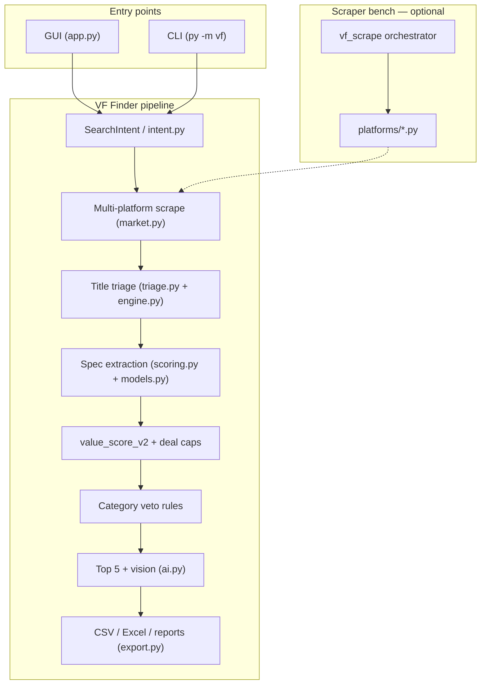

# VF Finder

[](https://github.com/YOUR_USERNAME/vf-finder/actions/workflows/ci.yml)
[](https://www.python.org/downloads/)
[](LICENSE)

**Assistant shopping seconde main** — scrape multi-plateforme, triage IA, scoring expert avec veto, et top deals via GUI ou CLI.

---

## Features

| Capability | Description |
|------------|-------------|
| **Scrape multi-plateforme** | Vinted, LeBonCoin, eBay, Wallapop, Rakuten, Cash Express — isolation par plateforme, reprise sur erreur |
| **Triage IA** | Filtrage titres keep / reject / doubtful ; promotion des cas ambigus ; LLM batch sur OpenRouter (optionnel) |
| **Scoring expert** | Extraction specs par catégorie (`CategoryConfig`), MSRP, tiers marque, `value_score_v2` |
| **Veto absolu** | Red flags catégorie (SVGA obsolète, iCloud lock, HS…) — rejet même à 1 € |
| **Top deals** | Classement, top 5 analyste, vision top-K, export CSV / Excel / rapports |
| **GUI** | Interface CustomTkinter : recherche, filtres, résultats triables, lancement pipeline complet |

---

## Architecture



**Pipeline simplifié :** `Intent → Catalog scrape → Triage titres → Extraction specs → Scoring + veto → Deep fetch / vision → Export`

---

## Quickstart

### Prerequisites

- **Python 3.10+**
- **Google Chrome** (certaines plateformes anti-bot exigent un bootstrap manuel captcha/cookies)
- Windows : le launcher `py` est recommandé ; macOS/Linux : `python3`

### Install

```bash
python -m pip install -r requirements.txt
```

Ou installation modulaire via `pyproject.toml` :

```bash
python -m pip install -e ".[all]"    # tout (GUI + scrapers + export)
python -m pip install -e ".[gui]"    # GUI seulement
python -m pip install -e ".[scrape]" # scrapers seulement
```

### Environment (`.env`)

```bash
# Windows PowerShell
Copy-Item .env.example .env

# macOS / Linux / Git Bash
cp .env.example .env
```

Éditez `.env` et renseignez `OPENROUTER_API_KEY` (optionnel — heuristiques seules si absent ou `VF_NO_AI=1`).

| Variable | Description |
|----------|-------------|
| `OPENROUTER_API_KEY` | Clé OpenRouter pour triage LLM et vision top-K |
| `VF_NO_AI=1` | Force le mode heuristiques uniquement |
| `VF_VERBOSE=1` | Logs détaillés |

### Run the GUI

```bash
python -m vf --gui
```

**Windows** — double-clic ou :

```bat
run_gui.bat
```

**macOS / Linux** — même commande `python -m vf --gui` (pas de `.bat` requis).

### Run the CLI

```bash
# Vidéoprojecteur, budget 50–900 €
python -m vf --q "video projecteur" --category projector --price-min 50 --price-max 900

# Console Nintendo 3DS
python -m vf --q "new 3ds xl" --category console_ds

# URL Vinted directe
python -m vf --url "https://www.vinted.fr/catalog?search_text=..." --category projector

# Navigateur visible (captcha / cookies)
python -m vf --q "playstation 5" --category console_ps4 --headed

python -m vf --help
```

### Scraper bench (développement)

```bash
python -m vf_scrape --bench-all -q "video projecteur" --category projector --price-min 50 --price-max 900 -v --csv
python -m vf_scrape --test-scrapers -p vinted -q "video projecteur" --category projector -v
```

---

## Category system (`CategoryConfig`)

La source de vérité catégorie est `vf/models.py` — dataclass `CategoryConfig` :

```python
@dataclass(frozen=True)
class CategoryConfig:
    categorie: str
    label: str
    brand_tiers: Dict[int, Tuple[str, ...]]
    specs_a_extraire: Tuple[str, ...]
    red_flags_veto: Tuple[str, ...]      # rejet immédiat
    red_flags: Tuple[str, ...]
    pack_complet: Tuple[str, ...]
    deal_min_discount_tier: Dict[int, float]
    extraction_hint: str
    expert_veto_note: str
```

**Catégories intégrées :** `projector`, `console_ds`, `console_ps4`, `bicycle`, `ac`, `phone` (+ alias `clim`, `velo`, `console_*`).

### Ajouter une catégorie

1. Ouvrir `vf/models.py` et ajouter une entrée dans `_CATEGORY_CONFIGS` :

```python
"mycat": CategoryConfig(
    "mycat",
    label="mon produit",
    brand_tiers={1: ("marque_a",), 2: ("marque_b",), 3: ()},
    specs_a_extraire=("modele", "etat"),
    red_flags_veto=("hs", "critical_defect"),
    red_flags=("accessory_only",),
    pack_complet=("item", "has_charger"),
    deal_min_discount_tier={1: 12.0, 2: 25.0, 3: 38.0},
),
```

2. Optionnel : règles d'extraction dans `vf/scoring.py` (`extract_specs` par catégorie).
3. Optionnel : presets plateformes dans `vf/engine.py` (`GUI_PLATFORM_PRESETS`).
4. Lancer les tests : `python -m unittest discover -s vf -p "test_*.py"`.

`get_category_config("mycat")` alimente prompts LLM (`prompt_block()`), veto scoring et seuils deal.

---

## Leçons apprises / historique

| Sujet | Leçon |
|-------|-------|
| **v2 abandonnée** | Une réécriture « v2 » monolithique a été abandonnée au profit du package `vf/` actuel : pipeline modulaire, 138 tests unitaires, GUI stable. Le score `value_score_v2` est la formule actuelle, pas un fork séparé. |
| **Scrapers** | Anti-bot réel (Vinted, LeBonCoin Datadome, eBay challenge). Nested threading + lock = deadlock Vinted → corrigé avec `RLock` et bootstrap timeout (`vf_scrape/session.py`). Plateformes fragiles (Wallapop, Rakuten, Cash Express) désactivées par défaut en GUI. |
| **Triage** | Heuristiques d'abord, LLM sur cas *doubtful* seulement — coût et latence maîtrisés. Intent strict évite les faux positifs (ex. accessoire vendu comme console). |
| **Veto** | Règles catégorie non négociables : SVGA sans HDMI, iCloud lock, écran cassé DS… Mieux vaut un rejet dur qu'un « bon plan » toxique. |
| **Données locales** | Runs, cookies, caches → `brouillon/data/` (gitignored). Jamais committer `.env` ni chemins machine. |

---

## Troubleshooting

| Problème | Solution |
|----------|----------|
| **Vinted vide / bloqué** | Relancer avec `--headed`, résoudre captcha une fois ; cookies persistés localement. Variables : `VF_VINTED_BROWSER_BOOT`, `VF_VINTED_HTTP_TIMEOUT`. |
| **LeBonCoin Datadome** | Cookies `brouillon/data/vf_cookies/lbc.json`, limiter `VF_LBC_RATE_PER_MIN`, cooldown `VF_LBC_BLOCK_COOLDOWN_MIN`. |
| **eBay challenge** | Mode visible : `--headed` ; valider captcha dans Chrome puis relancer. |
| **GUI : import error** | `python -m pip install ".[gui]"` (customtkinter, Pillow). |
| **Scrapers : import error** | `python -m pip install ".[scrape]"` (selenium, undetected-chromedriver, bs4). |
| **`python` introuvable (Windows)** | Utiliser `py` à la place de `python`, ou installer Python depuis python.org avec « Add to PATH ». |
| **PowerShell vs Bash** | PowerShell : `Copy-Item .env.example .env` — Bash : `cp .env.example .env`. Les exemples CLI fonctionnent dans les deux shells. |
| **IA indisponible** | `VF_NO_AI=1` ou laisser `OPENROUTER_API_KEY` vide — mode heuristiques. |

---

## Tech stack

| Layer | Technologies |
|-------|----------------|
| Langage | Python 3.10+ |
| GUI | CustomTkinter, Pillow |
| Scraping | Selenium, undetected-chromedriver, BeautifulSoup, aiohttp, requests, tenacity |
| IA (optionnel) | OpenRouter API (triage batch, vision top-K) |
| Export | CSV, openpyxl (Excel), rapports Markdown / JSON |
| CI | GitHub Actions (3.10, 3.11, 3.12) |
| Packaging | setuptools, `pyproject.toml`, entry points `vf` / `vf-finder` |

---

## Project structure

```text
vf-finder/
├── .github/workflows/ci.yml   # tests unitaires (VF_NO_AI=1)
├── .env.example               # modèle secrets (ne pas committer .env)
├── brouillon/                 # données locales (gitignored sauf README)
│   └── README.md
├── scripts/
│   └── test_scrapers.ps1      # helper PowerShell bench scrapers
├── vf/                        # package principal — CLI, GUI, pipeline, tests
│   ├── __main__.py            # point d'entrée CLI
│   ├── app.py                 # GUI CustomTkinter
│   ├── pipeline.py            # orchestration Intent → Export
│   ├── intent.py              # SearchIntent
│   ├── market.py              # scrape multi-plateforme
│   ├── triage.py              # triage titres
│   ├── scoring.py             # specs, value_score_v2, top deals
│   ├── engine.py              # filtres, taxonomy, infra
│   ├── models.py              # CategoryConfig (source de vérité catégorie)
│   ├── ai.py                  # LLM OpenRouter
│   ├── export.py              # CSV, Excel, rapports
│   └── test_*.py              # 138 tests unitaires
├── vf_scrape/                 # bench scrapers isolé (dev / CI scraper)
│   ├── __main__.py            # CLI bench
│   ├── orchestrator.py
│   ├── session.py
│   ├── bench_runner.py        # --test-scrapers
│   └── platforms/             # vinted, leboncoin, ebay, …
├── CONTRIBUTING.md
├── CODE_OF_CONDUCT.md
├── SECURITY.md
├── LICENSE                    # MIT
├── pyproject.toml
├── requirements.txt
├── run_gui.bat                # Windows : lance la GUI
└── README.md                  # cette documentation
```

---

## Files to publish (GitHub)

**Upload these** — everything a contributor or CI needs:

| Path | Why |
|------|-----|
| `vf/` | App source **and** `test_*.py` (138 unit tests — required by CI) |
| `vf_scrape/` | Scraper bench layer (`platforms/`, orchestrator, CLI) |
| `README.md`, `LICENSE`, `pyproject.toml`, `requirements.txt` | Docs + packaging |
| `.env.example`, `.gitignore` | Env template + ignore rules |
| `.github/workflows/ci.yml` | GitHub Actions test matrix |
| `CONTRIBUTING.md`, `SECURITY.md`, `CODE_OF_CONDUCT.md` | Community / security |
| `brouillon/README.md` | Explains local data layout (only this file — not `data/`) |
| `run_gui.bat` | Optional Windows launcher |
| `scripts/test_scrapers.ps1` | Optional PowerShell scraper bench helper |

**Never upload** (gitignored or local-only):

| Path | Why |
|------|-----|
| `.env` | API keys and secrets |
| `brouillon/data/` | Cookies, run exports, caches, logs (~4k local artifacts) |
| `bench_out/` | Scraper bench output |
| `__pycache__/`, `*.pyc`, `.pytest_cache/` | Python cache |
| `.cursor/`, `.vscode/`, `.idea/` | IDE metadata |
| `*.log` | Session / crash logs |

> **Note:** `vf/test_*.py` are **unit tests**, not throwaway junk — keep them in the repo; CI runs `unittest discover -s vf -p "test_*.py"`.

Before first push: `git init`, add the table above, commit, then `git push`. Your machine keeps `brouillon/data/` and `.env` locally; they never leave your disk.

---

## Tests

```bash
# Tous les tests unitaires (138)
python -m unittest discover -s vf -p "test_*.py"

# Mode sans IA (comme en CI)
VF_NO_AI=1 python -m unittest discover -s vf -p "test_*.py"
```

Sous Windows PowerShell :

```powershell
$env:VF_NO_AI="1"
py -m unittest discover -s vf -p "test_*.py"
```

---

## Screenshots

<!-- Remplacez par vos captures une fois la GUI déployée -->
| GUI — recherche | GUI — résultats |
|-----------------|-----------------|
| _screenshot_gui_search.png_ | _screenshot_gui_results.png_ |

> Ajoutez vos images dans `docs/screenshots/` et mettez à jour les liens ci-dessus.

---

## Contributing

Voir [CONTRIBUTING.md](CONTRIBUTING.md). Résumé : Python 3.10+, `pip install -r requirements.txt`, tests avant PR, ne jamais committer `brouillon/data/` ni `.env`.

---

## Security

Voir [SECURITY.md](SECURITY.md) pour signaler une vulnérabilité en privé.

---

## License

[MIT License](LICENSE) — Copyright (c) 2026 VF Finder contributors.
